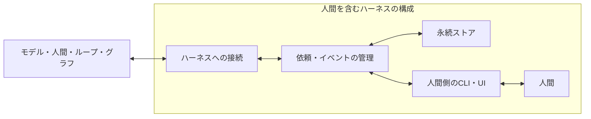

# 人間を組み込む共通機構の設計案

状態：初版の設計と実装範囲。理論や用途上の効果は、引き続き検討します。

## 初版の実装状況

共通基盤、SQLiteによる永続化、CLI、piへの接続を実装しています。具体的な操作とデータの契約は[実行基盤の仕様](runtime.md)、piでの操作は[piへの接続](pi.md)を参照してください。

自動通知、常駐スケジューラ、MCPサーバー、保存期間による自動削除は未実装です。下記には将来の設計候補も含みます。

## 構築するもの

人間への依頼と結果を非同期に受け渡す、ハーネスから利用できる共通基盤を作ります。人間とモデルの分担や処理手順は、呼び出し側に置きます。

人間をメモリとして使う、作業を委ねる、案を評価してもらうといった用途は、同じ機構に異なる依頼を渡して表現します。役割の列挙や企画書の処理手順を、共通APIの必須項目にしません。

## 構成と責務



| 部分 | 責務 |
|---|---|
| 呼び出し側 | 何を依頼するか、誰に依頼するか、何を待つか、結果をどう使うかを決める |
| 共通基盤 | 依頼、応答、途中のメッセージ、状態、配信と取り消しを管理する |
| 永続ストア | 接続やプロセスが終わっても、依頼と結果を保持する |
| 人間側の入出力 | 依頼と文脈を提示し、回答、質問、辞退などを受け取る |
| ハーネスへの接続 | 依頼IDと実行状態を対応付け、結果をモデルやグラフに渡す |

MCPとpiは接続方法の候補です。共通基盤の状態をpiの会話履歴だけに依存させない構成を提案します。

## 非同期の基本契約

1. 呼び出し側が依頼を登録する。
2. 共通基盤が依頼を永続化し、依頼IDを返す。ここでは人間の回答を待たない。
3. 人間が、その時点または後で依頼を確認し、回答や途中のメッセージを送る。
4. 共通基盤が結果とイベントを保存する。
5. 呼び出し側が結果を取得し、必要な処理を続ける。

依頼IDを返した後は、元の通信接続、モデル呼び出し、プロセスが継続している必要のない設計にします。人間待ちだけを理由にモデルを繰り返し呼び出しません。

依頼が未解決でも、独立した処理は継続できます。依存する処理だけを待機させるか、全体を待機させるかは呼び出し側が決めます。共通基盤では複数の依頼を独立に管理します。

## 操作の案

以下は内部APIの案です。MCPのメソッド名を新設する提案ではありません。

| 操作 | 内容 |
|---|---|
| `submit` | 依頼を保存して受付結果と依頼IDを返す |
| `get` | 指定した依頼の状態と結果を取得する |
| `respond` | 人間からの回答、質問、進捗、辞退を保存する |
| `cancel` | 指定した依頼を取り消す |
| `events` | カーソル以降のイベントを取得し、再接続時にも取りこぼしを回収する |

人間側の依頼一覧も提供します。初版ではCLIを候補とし、後から別のUIや通知手段を接続できるようにします。

## データの案

| データ | 主な内容 |
|---|---|
| 依頼 | 依頼ID、依頼者、宛先、依頼本文、文脈、任意の回答スキーマ、作成時刻 |
| 実行との対応 | 呼び出し元の実行ID、必要に応じた会話・分岐ID、文脈や成果物の版 |
| 制御情報 | 再送を識別するキー、依頼の版、任意の締切、保存期間 |
| 人間からの入力 | 入力ID、依頼ID、入力者、入力の種類、本文や構造化データ、対象の版 |
| イベント | イベントID、依頼ID、種別、時刻、順序、入力や状態への参照 |

回答スキーマは任意です。自由記述、選択肢、構造化した結果を扱えるようにします。用途上の「承認」「不承認」「修正要求」などは、呼び出し側が定義する回答内容に置きます。

## 状態の案

初版の依頼の状態は、`pending`（受付済み）、`in_progress`（対応中）、`completed`（結果あり）、`declined`（辞退）、`cancelled`（取り消し）、`expired`（期限切れ）、`failed`（失敗）です。人間からの質問や進捗は途中のイベントとして保持します。

「結果あり」は、人間の結果を受け取ったという意味です。依頼元の作業の完成、回答の正しさ、成果物の承認を意味しません。これらの解釈は呼び出し側が行います。

人間が質問した場合、呼び出し側にイベントを渡し、文脈を追記できるようにします。依頼の内容が変わる場合は版を更新します。

## 人間の特性から必要になる設計

| 特性 | 設計上の対応 |
|---|---|
| 数秒から数日まで応答時間が変わる | 永続的な依頼IDを返し、通信接続の寿命から切り離す |
| すぐには対応できない | 依頼一覧を保持し、対応中や進捗を任意で記録できる |
| 回答前に質問したい | 一回の回答だけでなく、依頼に結び付いた途中のメッセージを扱う |
| 回答できない、引き受けない | 不明という回答、辞退、操作上の失敗を区別する |
| 後から前提や依頼が変わる | 文脈と依頼の版を持ち、古い版への入力を識別する |
| 同じ入力や通知が再送される | 入力IDと再送を識別するキーで、効果の重複を防ぐ |
| 締切後に回答することがある | 遅延した入力を識別し、元の処理へ自動適用しない |
| 作業に着手してから取り消される | 基盤上の取り消しを記録し、人間の行為自体の巻き戻しとは区別する |

## 締切・保存期間・取り消し

人間の回答締切、通信のタイムアウト、依頼の保存期間は別々に扱います。締切は任意です。締切がない依頼を、通信が切れたことだけで失効させません。

締切を設定する場合は、締切後に入力を受理するか、履歴として残すかを明示します。初期案では期限切れイベントを保存し、後着の入力を元の実行へ自動適用しません。再依頼は呼び出し側の判断です。

取り消しと回答が競合した場合は、保存時に状態と版を検査し、確定した状態を返します。取り消しは、人間が既に行った現実の作業を元に戻すものではありません。人間が画面を閉じただけの場合に、依頼全体を取り消すかどうかも接続側で明示します。

## 配信・永続化・再開

依頼の状態と配信対象のイベントを、同じ永続ストアで記録する方式を候補とします。最初の実装ではSQLiteを検討します。

イベントは再取得可能にします。通知が届かなかった場合も状態と結果を読み直せるようにし、一度だけ届くという前提を置きません。ハーネス側もイベントIDを記録して、同じ結果の再適用を防ぎます。

呼び出し元のチェックポイントと依頼ストアが別の場合、一つのトランザクションで両方を保存できるとは限りません。同じキーで依頼を再登録すると元の依頼を返すことと、依頼ID・イベントIDを使った照合で、中断から回復できるようにします。

人間の結果が到着することと、モデルやグラフが再開することは別の処理です。共通基盤は結果を保持し、接続側が対応する実行を読み込んで結果を反映します。呼び出し側が終了している場合も結果は残ります。自動で再開するには、接続側のプロセスやスケジューラが必要です。

## MCP・pi・グラフとの接続

MCPで表現できる部分は[MCPとの比較](mcp.md)にまとめます。非同期タスクの状態は既存のTasks拡張と対応付け、未対応クライアントでは通常ツールで依頼IDを返す方式などを検討します。

pi拡張では、依頼登録用ツール、人間が使うコマンド、イベントの取得、会話への結果の提示を実装する案です。処理を待つか続けるか、再開時の分岐との対応は接続側の責務です。以前の案にあった「人間への依頼を出したら全処理を終了する」は、共通仕様には含めません。

グラフエンジンでは、依頼IDをノードのチェックポイントに保存し、その結果に依存する処理の再開条件にできます。人間の役割や次の処理を、共通基盤が決めることはありません。

## 初版で確かめること

1. 任意の依頼を登録し、人間の回答より先に依頼IDを返せる。
2. 基盤と呼び出し側を終了・再開しても、依頼と結果を回収できる。
3. 複数の未解決の依頼を、混同せず扱える。
4. 回答、途中の質問、不明という回答、辞退、取り消し、締切を扱える。
5. 再送や中断後の再試行で、依頼や結果の効果が重複しない。
6. 古い依頼や別の実行・分岐への結果を識別できる。
7. piなど一つのハーネスから登録し、結果をその実行へ返せる。

初版では、共通基盤とCLIの往復、およびpiのローダーと接続をテストしています。MCP接続は既存仕様との対応を確定した後に実装範囲を決めます。企画書作成は、その上で動く一つの利用例です。実モデルの判断や文章生成の評価は別に行います。

## 公開する構成の案

```text
README.md                 プロジェクトの入口
docs/                     理論・共通機構・MCPとの対応
src/core/                 依頼、入力、イベント、状態遷移
src/store/                永続化
src/adapters/pi/          piへの接続
src/adapters/mcp/         MCPへの接続候補
src/cli/                 人間側の入出力と確認用の操作
examples/proposal/        企画書作成という利用例
tests/                    中断、再送、競合、接続の検証
```

実際の初版では、永続化を`src/core/runtime.ts`に、CLIを`src/cli.ts`に、piへの接続を`src/adapters/pi.ts`に実装しています。仮称はHuman-in-the-Harness、リポジトリは`ieuko/human-in-the-harness`です。MCPへの接続とライセンスは未設定です。
