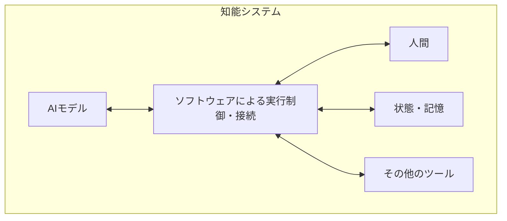

# 理論のたたき台

状態：議論用の草案。ここでの定義は、このプロジェクトで検討する作業上の定義です。

## 分析する単位

知能システムを、AIモデル・人間・ソフトウェア・その他の構成要素と、その結合として扱います。全体としての認識・記憶・推論・評価・行動が、どの構成要素と接続によって実現されるかを記述します。構想の仮称をHuman-in-the-Harnessとします。

この草案でハーネスとは、モデルの呼び出し、情報の受け渡し、状態の保持、行動の実行、制約の適用を実現する構成です。これらの機能の一部を人間が担えるものとします。

ソフトウェアはハーネスの実装の一部です。人間は、記憶の補完、評価、処理の振り分けなどを実際に行うことで、その構成に参加します。

## 構成要素・機能・接続方法を分ける

人間がシステムの構成要素であることと、人間がハーネスの機能を担うことは区別します。人間が情報を返す場合、調査の進め方を選ぶ場合、モデルに渡す文脈や次の呼び出しを制御する場合では、実現する機能が異なります。

ツールは呼び出しの形式、エージェントは行動を選ぶ主体としての捉え方、ハーネスはモデルの実行を支える機能として扱います。ツール形式の接続を通じて、人間がエージェントとして働くことも、ハーネス機能を担うこともできます。

Human as Harnessは、人間がコンテキスト管理、実行制御、状態の継続などを担う構成を指す表現として残します。共通の接続基盤だけで、その構成を実現したことにはしません。利用側で人間の入力をその機能に結び付ける必要があります。

## 人間コンポーネントの定義

人間がシステムに参加する際の、依頼の受け取り、応答、途中のやり取り、状態の継続を、明示的な接続仕様として記述します。これを人間コンポーネントと呼びます。人間が何を担当するかは、その接続を利用する側が決めます。

記述する項目は次のとおりです。

| 項目 | 記述する内容 |
|---|---|
| 参加者 | どの人間が担当するか |
| 提供する機能 | 任意の機能。記憶、観察、評価などの役割名は必要な場合に利用側が付ける |
| 依頼 | 何を求め、判断に必要な何を提示するか |
| 応答 | 回答、わからない、修正要求、辞退など |
| 時間と利用可能性 | いつ応答でき、応答まで何を待機させるか |
| 実行との対応 | どの依頼・実行・文脈に対する入力か。入力の利用方法は呼び出し側が定める |

同じ人が複数の機能を担えます。一つの機能を複数の構成要素で実現することもできます。役割の割り当ては、モデルや人間の判断、ループやグラフの構成によって変えられます。

## 共通機構と利用方法

共通機構は、依頼と結果を非同期に受け渡します。依頼の受付時には依頼IDを返し、人間が後から応答しても、元の依頼と対応付けられるようにします。元のモデル呼び出しや通信接続が継続していることを前提にしません。

例えば、人間の記憶への照会に使う場合、呼び出し側は結果を知識として参照できます。文書のレビューに使う場合、結果を次の修正や完了の条件として使えます。用途に応じた意味づけは、共通機構の外で行います。

人間を呼び出す機構と、人間に何を担当させるかを別々に記述します。企画書作成は、この関係を具体化する一つの利用例です。レビューの必須化や、同時に未解決の依頼を一件にする制約を、共通機構には固定しません。

## 一つの系として扱う範囲

共通機構の分析対象は、依頼、人間との相互作用、結果、呼び出し側への接続です。一つの知能システムとして評価する範囲は、それを組み込むハーネスや課題に応じて設定します。

系の境界は、課題に応じた分析上の選択です。全体の能力を評価する際は、人間が行った作業量と、外部から加えた情報を含めて報告します。

## マルチエージェントとの関係

人間が自ら計画を立て、依頼を変更し、役割を交渉する場面は、複数の主体の協調として分析できます。今回の上位の枠組みでは、人間・モデルに加えて、記憶や制御規則も含めたハーネスの構成を記述します。

役割の割り当てや交渉は、モデル・人間・ループ・グラフの側で実現できます。共通基盤は、その判断に応じて依頼と結果を受け渡せるようにします。

## 検証したい仮説

1. 人間との相互作用を接続仕様として定めると、同じ機構を異なる役割や処理構造に組み込める。
2. 人間への依頼を永続化すると、人間の応答時間とモデルの実行時間を分離しながら、同じ作業を継続できる。
3. 依頼・入力・文脈・実行の対応を保持すると、非同期の結果をハーネスへ組み込む際の振る舞いを検証できる。

これらは未検証です。最初の実装では、仕組みの再利用、非同期の往復、中断と再開を確かめます。課題の品質改善は、利用側の構成も含めて別に検証します。

## 理論として今後詰める点

- 同じ人間が指示者・記憶・評価者になる場合、それぞれの発言をどう区別するか。
- 人間が不在、辞退、記憶が不確かな場合、全体の能力と制約をどう記述するか。
- 人間との相互作用によって目的自体が変わる場合をどう扱うか。
- 誰が人間とモデルの役割分担を設定し、変更するか。
- 既存の分散認知や人間参加型の実装に対して、どの記述・設計方法を追加できるか。

既存研究との接続は[参考文献](references.md)に記録します。
